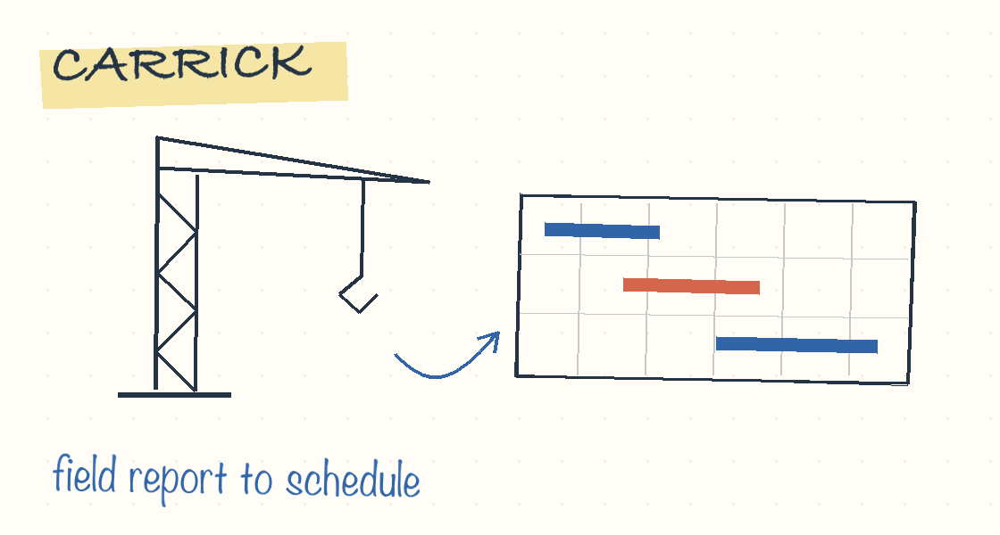
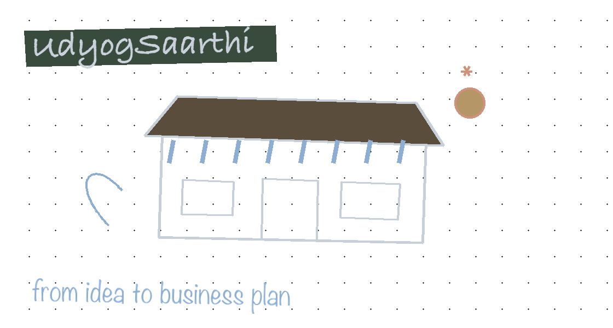
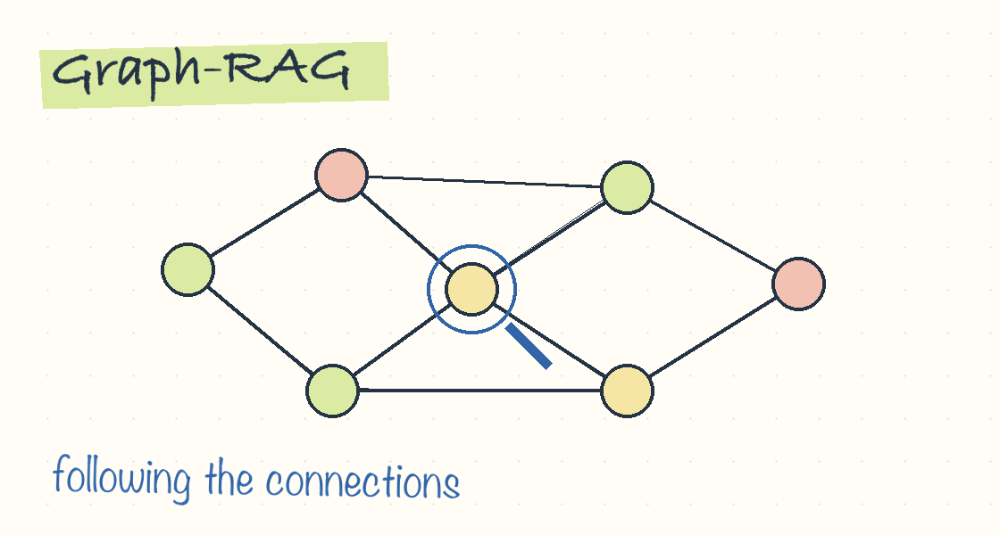
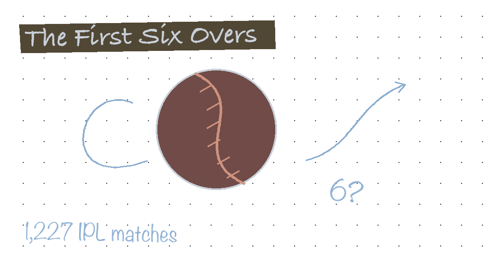

<picture><source media="(prefers-color-scheme: light)" srcset="assets/sketchbook/header-animated-light.svg"></picture>

Hey, I'm **Arnav**. I'm studying Computer Engineering at **NMIMS, Mumbai**. Most of my coding time goes into Python, AI apps, and the APIs behind them.

Outside code: gym, badminton, treks, beaches, and F1. Music-wise, a bit of everything.

[Email](mailto:deshpandearnavn@gmail.com) · [LinkedIn](https://www.linkedin.com/in/arnav-deshpande-35251b202/)

## a few things i've worked on

<table>
<tr>
<td width="50%" valign="top">
<a href="https://github.com/andy1924/CARRICK"><picture><source media="(prefers-color-scheme: light)" srcset="assets/sketchbook/carrick-light.png"></picture></a>

Site updates come in as reports; schedules need dates and activities. CARRICK connects the two, with AI suggesting matches and planners checking them before export.

Python · SQLite · RAG <a href="https://github.com/andy1924/CARRICK/blob/main/docs/architecture/system.md">Architecture</a> · <a href="https://github.com/andy1924/CARRICK/tree/main/tests">Tests</a>

</td>
<td width="50%" valign="top">
<a href="https://github.com/andy1924/UdyogSaarthi"><picture><source media="(prefers-color-scheme: light)" srcset="assets/sketchbook/udyog-light.png"></picture></a>

Built with a team to help rural entrepreneurs work through a business idea: feasibility, finances, compliance, and a project report, in multiple languages.

FastAPI · PostgreSQL / PostGIS · React · Celery <a href="https://github.com/andy1924/UdyogSaarthi/blob/main/docs/systemDesign.md">System design</a> · <a href="https://github.com/andy1924/UdyogSaarthi/blob/main/docs/apiDocs.md">API</a>

</td>
</tr>
<tr>
<td width="50%" valign="top">
<a href="https://github.com/andy1924/Graph-RAG"><picture><source media="(prefers-color-scheme: light)" srcset="assets/sketchbook/graph-light.png"></picture></a>

Research I co-authored on using knowledge graphs for RAG. We compared multimodal, graph-based retrieval with a chunk-based baseline and measured answer quality, hallucinations, and response time.

Python · Neo4j · ChromaDB <a href="https://github.com/andy1924/Graph-RAG/blob/main/docs/ARCHITECTURE.md">Architecture</a> · <a href="https://github.com/andy1924/Graph-RAG/blob/main/docs/EVALUATION.md">Evaluation</a>

</td>
<td width="50%" valign="top">
<a href="https://github.com/andy1924/The-First-Six-Overs"><picture><source media="(prefers-color-scheme: light)" srcset="assets/sketchbook/cricket-light.png"></picture></a>

I went through ball-by-ball data from 1,227 IPL matches to see how much the toss and those first six overs matter. Runs, wickets, and a fair bit of R.

R · Cricsheet · hypothesis testing · regression <a href="https://github.com/andy1924/The-First-Six-Overs/blob/main/analysis.md">Findings</a> · <a href="https://github.com/andy1924/The-First-Six-Overs/blob/main/R/01_analysis.R">Analysis</a>

</td>
</tr>
</table>

Another team build: **[AtlasAI](https://github.com/andy1924/AtlasAI)**. I led the AI/ML side: a LangGraph agent, retrieval memory, and carrier forecasting. It's a logistics prototype; the fleet dashboard uses simulated vessel positions.

if you want to get into the details

### CARRICK

The XER export can be parsed back successfully. It still needs an independent import check in Oracle P6. [Export checks and tests](https://github.com/andy1924/CARRICK/tree/main/tests).

### Graph-RAG

Here's what our benchmark reported:

| Metric | GraphRAG | Chunk-based baseline |
| --- | ---: | ---: |
| Hallucination rate | 0.33% | 2.04% |
| Mean response time | 6.00 s | 4.02 s |
| Semantic similarity | 0.5881 | 0.8308 |

In this run, GraphRAG hallucinated less, but took longer and scored lower on semantic similarity. These results depend on the corpus, metric definitions, and evaluation setup. The two pipelines also define retrieval F1 differently, so those F1 scores aren't directly comparable.

[Results and limitations](https://github.com/andy1924/Graph-RAG#current-results-snapshot-repository-json) · [Benchmark data](https://github.com/andy1924/Graph-RAG/blob/main/results/visual_output/tab1_aggregate_metrics.csv)

I'm looking for opportunities in **AI, backend, and full-stack engineering**. If you've got a project I could help with, [say hello](mailto:deshpandearnavn@gmail.com).
