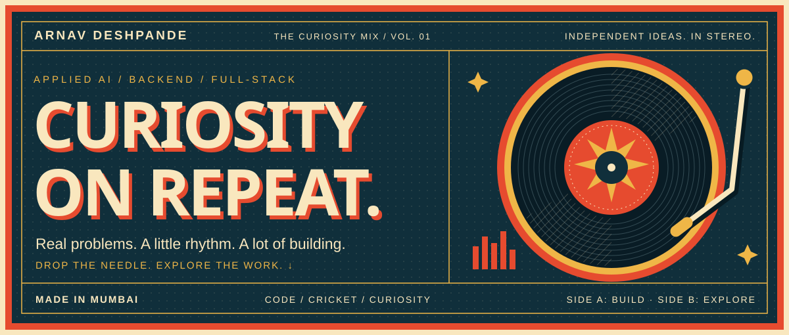
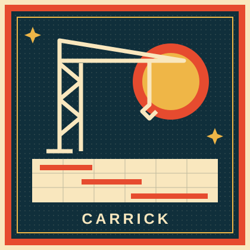

  

  <a href="#side-a--things-i-build">▶ PLAY THE PROJECTS</a> &nbsp; / &nbsp;
  <a href="#side-b--off-the-clock">↻ FLIP THE RECORD</a> &nbsp; / &nbsp;
  <a href="mailto:deshpandearnavn@gmail.com">↗ SAY HELLO</a>

# Hey, I'm Arnav. Welcome to the mix. 🎧

Computer Engineering at **NMIMS, Mumbai**. I build **AI applications, backend systems, and the interfaces around them** — usually with music on and one more idea than I have time for.

My projects take me from infrastructure sites to rural businesses to cricket scorecards. The common thread? A question I couldn't leave alone.

**On the turntable:** RAG, AI agents, and software that turns a messy input into a useful next step.

---

## Side A / Things I build

*Four tracks. Pick your rabbit hole.*

<table>
<tr>
<td width="150" align="center">

</td>
<td>
<h3>01 / <a href="https://github.com/andy1924/CARRICK">CARRICK</a></h3>

<strong>From “here's what happened on site” to “here's what changes in the schedule.”</strong>

AI matches field reports to schedule activities. Planners review the proposed changes before export. Built with access controls, source evidence, and conflict checks.

<code>Python</code> <code>SQLite</code> <code>RAG</code>

<a href="https://github.com/andy1924/CARRICK/blob/main/docs/architecture/system.md">Architecture ↗</a> · <a href="https://github.com/andy1924/CARRICK/tree/main/tests">Tests ↗</a>

</td>
</tr>
<tr>
<td width="150" align="center">

</td>
<td>
<h3>02 / <a href="https://github.com/andy1924/UdyogSaarthi">UdyogSaarthi</a></h3>

<strong>A business idea deserves somewhere to start.</strong>

A team-built multilingual platform for rural entrepreneurs: feasibility, financial calculations, compliance, and project reports, with applicant, reviewer, and auditor roles.

<code>FastAPI</code> <code>PostgreSQL / PostGIS</code> <code>React</code> <code>Celery</code>

<a href="https://github.com/andy1924/UdyogSaarthi/blob/main/docs/systemDesign.md">System design ↗</a> · <a href="https://github.com/andy1924/UdyogSaarthi/blob/main/docs/apiDocs.md">API contract ↗</a>

</td>
</tr>
<tr>
<td width="150" align="center">

</td>
<td>
<h3>03 / <a href="https://github.com/andy1924/Graph-RAG">Graph-RAG</a></h3>

<strong>“Sounds right” is an interesting place to start testing.</strong>

Co-authored research comparing multimodal, graph-based retrieval with a chunk-based RAG baseline. From ingestion and knowledge graphs to grounded answers and evaluation.

<code>Python</code> <code>Neo4j</code> <code>ChromaDB</code> <code>LLM APIs</code>

<a href="https://github.com/andy1924/Graph-RAG/blob/main/docs/ARCHITECTURE.md">Architecture ↗</a> · <a href="https://github.com/andy1924/Graph-RAG/blob/main/docs/EVALUATION.md">Evaluation ↗</a>

</td>
</tr>
<tr>
<td width="150" align="center">

</td>
<td>
<h3>04 / <a href="https://github.com/andy1924/The-First-Six-Overs">The First Six Overs</a></h3>

<strong>The cricket debate got out of hand. So I brought data.</strong>

An analysis of 1,227 completed IPL matches: toss effects, powerplay runs, and wickets, explored with hypothesis tests and logistic regression.

<code>R</code> <code>Cricsheet</code> <code>Statistical analysis</code>

<a href="https://github.com/andy1924/The-First-Six-Overs/blob/main/analysis.md">The findings ↗</a> · <a href="https://github.com/andy1924/The-First-Six-Overs/blob/main/R/01_analysis.R">The analysis ↗</a>

</td>
</tr>
</table>

**Bonus track / [AtlasAI](https://github.com/andy1924/AtlasAI)** — AI/ML lead on a team logistics prototype: a LangGraph agent, outcome-aware memory, human approval, and a NumPy LSTM for carrier forecasting. The fleet dashboard uses simulated vessel positions.

<strong>Liner notes / Engineering details & research trade-offs</strong>

### CARRICK

XER exports pass a parser round trip. Independent Oracle P6 import remains an external acceptance check. [Export and verification details](https://github.com/andy1924/CARRICK/tree/main/tests).

### Graph-RAG

The repository reports these aggregate benchmark results:

| Metric | GraphRAG | Chunk-based baseline |
| --- | ---: | ---: |
| Hallucination rate | 0.33% | 2.04% |
| Mean response time | 6.00 s | 4.02 s |
| Semantic similarity | 0.5881 | 0.8308 |

Lower hallucination rate came with higher latency and lower semantic similarity in this experiment. Results depend on the corpus, metric definitions, and evaluation setup. Retrieval F1 uses different definitions across the pipelines and should not be treated as a direct comparison.

[Results and limitations](https://github.com/andy1924/Graph-RAG#current-results-snapshot-repository-json) · [Benchmark data](https://github.com/andy1924/Graph-RAG/blob/main/results/visual_output/tab1_aggregate_metrics.csv)

## The instruments

| Part of the build | What I reach for |
| --- | --- |
| AI & retrieval | Python · RAG · LangGraph · Neo4j · ChromaDB |
| APIs & background work | FastAPI · PostgreSQL · Redis · Celery |
| Interfaces | React · TypeScript |
| Questions best answered with data | R · hypothesis testing · regression |

## Side B / Off the clock

🎧 **On repeat:** Daniel Caesar. 
🏏 **Likely distraction:** a cricket question with a suspiciously large dataset. 
💡 **Recurring habit:** “What if I built something for that?”

## Your idea could be the next track.

I'm open to **applied AI, backend, and full-stack engineering opportunities**, and always happy to talk about an interesting build.

[**Email Arnav ↗**](mailto:deshpandearnavn@gmail.com) &nbsp; · &nbsp; [LinkedIn ↗](https://www.linkedin.com/in/arnav-deshpande-35251b202/) &nbsp; · &nbsp; [Browse every repository ↗](https://github.com/andy1924?tab=repositories)

Made in Mumbai. Best explored with headphones on.

